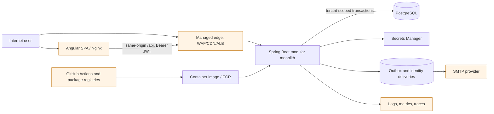

# Slotix Threat Model

**Review date:** 2026-10-21
**Scope:** `reservation-core` on `feat/multi-tenant-foundation` and its sibling Angular application, `../slotix-web`.
**Method:** repository evidence, local static tracing, existing integration tests, and dependency advisory queries. No production system, mailbox, cloud account, or external customer data was accessed.

## Executive summary

Slotix is a multi-tenant booking SaaS that processes identity data, company membership and role state, reservations, operational audit data, and email recovery links. Its strongest implemented controls are server-side re-resolution of user, company, membership, roles, and credential version on every JWT-authenticated request; database-backed tenant predicates; transactional booking state changes; an exclusion constraint for capacity-one resources; BCrypt passwords; and one-time recovery-token hashes.

The initial review identified availability and identity-boundary weaknesses rather than an observed tenant-isolation bypass. These have now received repository changes: bounded non-backtracking slug validation, distributed account rate limits, request-body limits, regional WAF rules, encrypted identity delivery tokens, mandatory JWT secret configuration, issuer/audience checks, short token lifetimes, and server-side logout revocation. Browser protections and build dependency controls are also implemented. See the remediation table in `security_best_practices_report.md` for verification and commits.

No confirmed SQL injection, DOM XSS, SSRF, path traversal, file-upload issue, or cross-tenant data disclosure was found in the reviewed paths. This is not a claim that the system is secure in every deployment: web-edge configuration, AWS account policy, production secrets, SMTP behavior, backup access, and live dependency exposure were outside the local evidence.

## Scope and assumptions

- Production data is treated as sensitive PII: names, emails, membership/role data, reservations, notes, cancellation reasons, resource schedules, audit records, and notification metadata. Payments, health data, anonymous public catalogues, and file uploads are out of scope because they are not implemented.
- The desired production posture is a public, high-concurrency API behind a managed edge. The Terraform associates a regional WAF with the internet-facing ALB, adds IP-based limits and alarms, and scales private tasks. These changes are locally validated configuration; no AWS runtime claim is made.
- The browser uses a same-origin `/api` proxy and keeps the short-lived bearer token only in memory. The API uses a stateless JWT Authorization header, not browser cookies. Therefore the current CSRF disablement is appropriate for the observed design, but must be re-evaluated before introducing cookie authentication.
- The AWS Terraform design provides TLS/HSTS at the ALB, WAF, private Fargate tasks, private encrypted RDS, ECR scan-on-push, Secrets Manager injection, CloudWatch alarms, and task autoscaling. It does not define CloudFront, web frontend deployment, remote Terraform-state controls, or AWS account guardrails.

## System model

### Primary components

| Component | Responsibility | Sensitive assets |
| --- | --- | --- |
| Angular web application | Browser UI, route guards, same-origin API calls | Access token in memory, reset/invitation URL token while used |
| Nginx web container | Serves SPA and proxies `/api` | Client IP forwarding, response headers |
| Spring Boot modular monolith | Identity, company, resource, availability, policy, booking, notification, audit | JWT signing key, authorization decisions, PII, recovery flow |
| PostgreSQL/Flyway | Transactional records and invariants | Password hashes, token hashes, encrypted delivery tokens, JWT revocations, rate buckets, PII, audit data |
| SMTP provider | Delivers booking and identity email | Recipient addresses and bearer recovery links |
| AWS ECS/ALB/RDS/Secrets Manager | Runtime network, compute, secrets, database | Database password, JWT signing secret, logs, backups |
| GitHub Actions and npm/Maven supply chain | Build, test, package, deploy inputs | Source integrity, dependency integrity, build artifacts |

### Data flows and trust boundaries

1. A browser submits credentials, a recovery request, or an authenticated API request across an internet-facing edge. The frontend attaches a bearer token only to same-origin API paths.
2. Spring Security verifies the JWT signature and expiry, then `IdentityAuthenticationService` loads current user, credential version, company, membership, and roles from PostgreSQL before authorizing the request.
3. A tenant-scoped service locks and queries data with `company_id` predicates, writes business data, audit entries, idempotency records, and outbox events in one transaction.
4. Workers claim rows from the outbox and deliver booking or identity email outside the originating transaction. Identity-delivery rows contain an AES-GCM envelope, decrypted in worker memory immediately before message creation. A separate injected secret supplies the encryption key.
5. ECS injects the database password and JWT secret from Secrets Manager. Fargate task logs and selected traces/metrics leave the workload for CloudWatch, X-Ray, or Datadog.

Trust boundaries are: internet-to-edge, browser-to-API, JWT-to-persisted-identity revalidation, company context to tenant-scoped data, application-to-database, application-to-SMTP, task-to-Secrets Manager, telemetry export, and CI/dependency inputs to released images.

## Assets

| Asset | Value and security objective |
| --- | --- |
| Password hashes and recovery credentials | Prevent account takeover and offline cracking. |
| JWT signing secret and active access tokens | Prevent token forgery and bearer-token replay. |
| Memberships, platform roles, and tenant context | Prevent privilege escalation and cross-company access. |
| Reservations, notes, schedules, and capacity state | Preserve confidentiality and booking integrity/availability. |
| PII and notification recipient data | Limit disclosure, excessive retention, and misuse. |
| Audit logs and outbox state | Preserve accountability without exposing secrets or becoming tamperable evidence. |
| Database passwords, SMTP credentials, telemetry keys | Restrict secret access and rotation. |
| Source, dependency lockfiles, CI workflows, and container images | Preserve build integrity. |
| Request capacity, database connections, workers, and SMTP quota | Maintain availability under malicious or accidental load. |

## Attacker model

| Actor | Capabilities considered |
| --- | --- |
| Internet attacker | Sends arbitrary HTTP requests, creates an ordinary account if invited, automates traffic, and observes public responses. |
| Authenticated customer | Has valid company membership but no staff privilege; can submit API bodies and inspect own responses. |
| Malicious company administrator | Can manage their tenant and attempt to access another tenant or abuse recovery/invitation flows. |
| Compromised administrator credential | Can use normal administration endpoints and bearer tokens. |
| Read-only database, backup, log, or delivery-queue reader | Can inspect persisted data but cannot necessarily modify it. |
| Compromised developer workstation or CI dependency | Can target build tooling, workflow credentials, or an image before release. |
| Cloud configuration mistake | Omits secrets, edge controls, headers, backup restrictions, or TLS-related settings. |

## Entry points and attack surface

| Surface | Authentication | Notes |
| --- | --- | --- |
| `POST /api/users/login`, `POST /api/platform/login` | Public | Password authentication and token issuance. |
| `POST /api/password-resets`, `/confirm`, and `/api/invitations/accept` | Public | Account recovery and invitation acceptance. |
| `/api/v1/**`, `/api/companies`, `/api/platform/**` | JWT | Company and platform administration, bookings, policies, audit, operations. |
| `/swagger-ui.html`, `/v3/api-docs/**`, health endpoints | Public | Documentation and basic health information. |
| Browser runtime configuration and Nginx proxy | Public | SPA bootstrap and same-origin routing. |
| SMTP and OTLP endpoints | Network egress | External systems receiving tenant-related data. |
| Terraform, Dockerfiles, Maven/npm lockfiles, GitHub Actions | Build/deployment | Supply-chain control plane. |

## Top abuse paths

The paths below preserve the initial attack analysis. Current mitigations and residual deployment requirements are recorded in the companion report; these are not assertions that all original paths remain exploitable.

1. **Request-thread exhaustion through slug validation.** An authenticated requester submits a very long alternating slug to an onboarding/company endpoint. Java's nested repeated regex can overflow the request thread stack before a normal validation response.
2. **Credential stuffing and recovery abuse.** A bot sends distributed login and password-reset requests through the public ALB. No repository-visible WAF or distributed rate limit limits attempts across ECS tasks.
3. **Recovery-link theft from a read-only persistence path.** A database backup, report, or compromised low-privilege reader retrieves plaintext `identity_email_deliveries.token` before the email worker clears it, then resets an account or accepts an invitation.
4. **Fallback JWT-key deployment.** A deployment launched with the committed default signing key lets an attacker who knows a valid subject and company UUID mint a correctly signed bearer token for that identity until the key is replaced.
5. **Release-pipeline compromise.** A developer/CI environment runs the vulnerable Vite development dependency or a mutable GitHub Action tag. The resulting code execution can alter source, build artifacts, or release credentials.
6. **Large text persistence.** An authenticated user sends oversized booking notes, cancellation reasons, or resource-block reasons. The API/database has no application-level bound for these fields, consuming request, database, audit, and response capacity.

## Threat model table

Priorities below describe the original unmitigated review baseline. Re-evaluate residual probability after staging validates the implemented controls.

| ID | Threat | Preconditions and path | Existing controls | Priority |
| --- | --- | --- | --- | --- |
| TM-01 | Regex stack exhaustion | Authenticated request reaches slug validation with a long adversarial string. | Authentication on company creation; no safe bounded parser. | High |
| TM-02 | Credential stuffing, reset spam, and API DoS | Public endpoint reachable from internet; attacker distributes source IPs. | Generic reset response, per-account reset cap, short JWTs. | High |
| TM-03 | Recovery/invitation token disclosure | Read access to database, backup, SQL export, or an overly broad operational path during token lifetime. | 256-bit randomness, token hash for domain record, delivery cleanup after send/use/expiry. | High |
| TM-04 | Unsafe JWT fallback | Non-AWS or misconfigured deployment omits injected secret. | AWS Terraform injects a secret; current roles/credential version are reloaded. | Medium |
| TM-05 | Tenant data exposure or privilege escalation | Forged role claims, stale token, or cross-company object ID. | Signature/expiry validation, persisted role/membership/company re-resolution, tenant predicates, integration tests. | Medium, no bypass found |
| TM-06 | Stored XSS or browser token theft | Attacker-controlled API content reaches an executable DOM sink. | Angular interpolation, no observed HTML/code sinks, token only in memory. | Medium, no exploitable path found |
| TM-07 | Build or development supply-chain execution | Developer/CI runs npm tooling or mutable actions. | Lockfile, frontend audit jobs, backend pinned actions, ECR scan-on-push. | Medium |
| TM-08 | Unbounded request/data growth | Authenticated user posts large text fields or high-volume API traffic. | Some DTO limits, calendar/page limits, booking idempotency, database constraints. | Medium |

## Criticality calibration

Priority combines exposure, attacker prerequisites, and impact on confidentiality, integrity, or availability. A high finding can block production when a public or broadly authenticated path can affect identity, tenant data, or service availability. Medium findings require a bounded remediation plan before handling sensitive production data. Recommendations are not reported as exploitable vulnerabilities when the missing control may exist outside this repository.

The model uses the following desired production decisions:

- Place a managed WAF in front of all public traffic with rate-based controls, bot filtering, request-size limits, and observability; use application/account limits for identity endpoints so controls work across Fargate tasks.
- Require MFA or federated phishing-resistant SSO for platform administrators and strongly encourage it for company administrators.
- Treat recovery links as secrets equal to an active short-lived credential and encrypt any durable outbox copy with a separate KMS-controlled key.
- Use a secret-required startup policy, short access-token lifetime, issuer/audience checks, controlled key rotation, and a server-side revocation design for security-sensitive logout or incident response.

## Focus paths reviewed

- JWT generation, parsing, filter processing, current-user/role/membership resolution, and credential-version invalidation.
- Company, resource, policy, availability, booking, lifecycle, audit, invitation, password-reset, notification, and platform-operation paths.
- JPA/JdbcTemplate queries, Flyway constraints, PostgreSQL exclusion constraint, outbox claiming, and tenant identifiers.
- Angular session/interceptor/route handling, runtime configuration, templates, Nginx proxy/headers, Docker images, CI workflows, and npm dependencies.
- AWS Terraform networking, TLS listener, RDS isolation/encryption, ECS secret injection, IAM access, logging, and alarms.
- Follow-up runtime scans cover Ubuntu/Alpine packages and the backend's embedded Java libraries. The initial scan found affected dependency versions; patched images have zero HIGH/CRITICAL entries without CVE exclusions. This does not establish the absence of lower-severity or unknown vulnerabilities.

## Quality check

- Scope includes both repositories and the deployment code stored with the backend.
- Assets, actors, entry points, trust boundaries, data flows, abuse paths, and existing controls are concrete to the code reviewed.
- Confirmed findings are separated from production-runtime validation gaps in `security_best_practices_report.md`.
- The initial audit was read-only. Subsequent user-authorized remediations changed the repositories; their commits, verification, and rollout requirements are recorded in the companion report.
